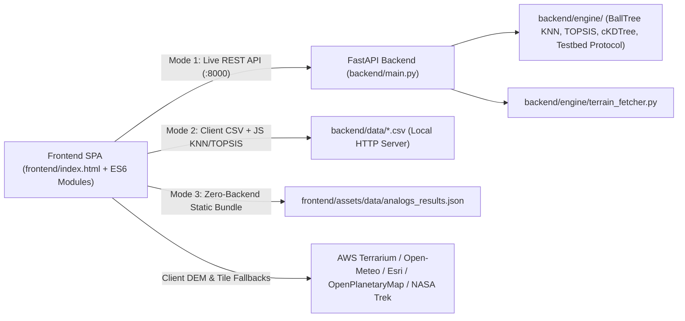

# DLT_NASAHackathon2026 — Planetary Analog Finder & 3D Terrain Explorer

An interactive 3D planetary visualization and machine-learning analog matching platform built for the **2026 NASA International Space Apps Challenge**:
**[Identify Earth Locations that Analog the Permanent Moon Base Locations and Mars](https://www.spaceappschallenge.org/2026/challenges/permanent-moon-base-locations-and-mars/)**.

Live Demo (GitHub Pages): **https://dlampy.github.io/DLT_NASAHackathon2026/**

---

## Overview

Testing rovers, ISRU drills, habitats, and astronaut hardware for lunar and Martian missions requires finding terrestrial field sites that match specific planetary conditions—while explicitly warning engineers where Earth analogs break down (gravity, hard vacuum vs. thin $\text{CO}_2$, abrasive electrostatic dust, and regolith depth).

**DLT_NASAHackathon2026** combines:
1. **Interactive 3D Globes (Three.js)** for Earth, Moon, and Mars with 8K surface textures, axial tilt toggle (`Upright Axis`), Google Earth-style navigation (`ge-nav`), 3D analog pins, and dual-planet orbital arc linking.
2. **Mission Target Finder (`Moon` / `Mars` → `Earth`)**: A 3-step Mission Wizard, direct **Reselect 3D** coordinate picking on Moon/Mars globes, two-way **2D View ↔ Mission Finder** picking (`Pick from 2D View` / `Use for Mission Finder`), and quantitative **Weighted BallTree KNN → Analog TOPSIS** ranking across **7 mission profiles** and **51 cleaned terrestrial analog sites**.
3. **3D Terrain Comparator**: Standalone and linked WebGL DEM cutaway relief viewer (`Dual Compare` & `Single Site` modes, expandable layout, synchronized cameras, vertical exaggeration slider, surface imagery / elevation ramp / wireframe modes).
4. **FastAPI + 17-Factor Analytical Backend**: REST API supporting coordinate snapping over 100-zone lunar/Martian grids (`cKDTree`), 17-factor KNN + TOPSIS matching with pairwise lithology/mineral compatibility matrices, 3-tier **Earth Testbed Protocol** generation (NASA regolith simulants `LHS-1`, `JSC-1A/LMS-1`, `MMS-1/MGS-1`), and server-side DEM extraction + tile CORS proxying.

---

## Architecture & Runtime Fallback Modes



The frontend automatically selects the best available data runtime without manual configuration:
1. **Mode 1 — Live FastAPI Backend** (`http://127.0.0.1:8000/api` or same-origin `/api`): Uses Python `scikit-learn` `BallTree`, `planetary_resolver.py`, `terrain_fetcher.py`, and `/api/terrain/proxy-tile`.
2. **Mode 2 — Browser CSV + JS Engine**: When served via `start_local.bat`, `python frontend/app.py --serve`, or an HTTP server at repo root without FastAPI running, `csvAndTopsis.js` fetches `../backend/data/*.csv` directly and computes Weighted KNN → TOPSIS + Moon/Mars point profiles in browser memory.
3. **Mode 3 — Static Precomputed Bundle (GitHub Pages)**: Uses `frontend/assets/data/analogs_results.json` plus client-side Terrarium/Open-Meteo/Esri/OpenPlanetaryMap APIs and local 8K textures.

---

## Repository Structure

```text
DLT_NASAHackathon2026/
├── .github/workflows/
│   └── deploy-pages.yml            # GitHub Actions CI deploying ./frontend to GitHub Pages
├── .gitignore
├── LICENSE                         # MIT License (Copyright 2026 Quang Duc Lam Nguyen)
├── pyrightconfig.json              # Python type-checker path configuration (backend/)
├── README.md                       # Root project documentation (this file)
│
├── backend/                        # FastAPI server, ML matching engines, datasets & ETL scripts
│   ├── README.md                   # Backend architecture, 11 API endpoints, DEM & data pipeline docs
│   ├── main.py                     # FastAPI entrypoint (mounts /api, /backend/data, and frontend /)
│   ├── requirements.txt            # Core Python dependencies
│   ├── api/
│   │   ├── routes.py               # REST endpoints (/health, /domains, /presets, /targets, /missions, /analogs/*, /resolve, /search, /terrain/*)
│   │   └── schemas.py              # Pydantic request/response validation schemas
│   ├── engine/
│   │   ├── preprocessor.py         # 17-factor normalization, domain buckets & lithology/mineral matrices
│   │   ├── knn_filter.py           # Stage 1 BallTree KNN candidate retrieval
│   │   ├── topsis_ranker.py        # Stage 2 dual-ideal TOPSIS ranking & out-of-Earth-bounds diagnostics
│   │   ├── matcher.py              # 5-factor frontend-aligned KNN -> TOPSIS matcher & bundle exporter
│   │   ├── planetary_resolver.py   # 100-zone cKDTree coordinate snapping (Moon.csv & mars.csv)
│   │   ├── resolvers/
│   │   │   ├── moon_resolver.py    # Analytical lunar physics & PSR/mare/pit fallback model
│   │   │   └── mars_resolver.py    # Analytical Martian physics & barometric/cave fallback model
│   │   ├── testbed_protocol.py     # 3-tier field site, NASA regolith simulant & compensation protocol engine
│   │   └── terrain_fetcher.py      # Earth/Moon/Mars DEM patch extractor & allowlisted tile CORS proxy
│   ├── data/
│   │   ├── merged_earth_features_clean.csv   # 51 cleaned Earth analog sites (29 feature columns)
│   │   ├── Moon.csv                          # 100 lunar regional reference zones
│   │   ├── mars.csv                          # 100 Martian regional reference zones
│   │   ├── missions.csv                      # 7 mission scenarios with feature weights
│   │   ├── site_tests.csv                    # 24 curated (site, mission) engineering rationales
│   │   ├── rawData/geological_sites_100.csv  # Initial 100-site terrestrial catalog
│   │   ├── processedData/                    # Intermediate GEE, NASA POWER, Open-Elevation & Macrostrat CSVs
│   │   └── placeholderData/                  # planetary_bases.csv (8 presets) & earth_sites_1000.csv (16 legacy)
│   └── scripts/                              # Colab notebooks (.ipynb) & Python CLI feature extractors
│
└── frontend/                       # Zero-build static SPA (Three.js r128 + Leaflet 1.9.4 + ES Modules)
    ├── README.md                   # Detailed UI controls, 3D/2D flows, terrain comparator & texture guide
    ├── index.html                  # Main SPA entry point
    ├── app.py                      # CLI helper to export analogs_results.json (--export-json) or serve UI (--serve)
    ├── start_local.bat             # Windows dependency-free local PowerShell HTTP server (ports 8080-8090)
    ├── assets/
    │   ├── data/analogs_results.json         # Precomputed TOPSIS bundle for static hosting
    │   └── textures/                         # Bundled 8k_earth_daymap.jpg, 8k_moon.jpg, 8k_mars.jpg + README.txt
    ├── src/
    │   ├── main.js                 # Bootstrap, WebGL init, URL query link support & animation loop
    │   ├── config/constants.js     # Planet metadata, 5 finder features, Leaflet tile layer definitions
    │   ├── state/appState.js       # Shared reactive UI & window state
    │   ├── scene/                  # threeScene.js, planetBuilder.js, markersAndArcs.js, geNavigation.js
    │   ├── ui/                     # welcomeModal.js, infoPanel.js, popups.js, windowManager.js
    │   ├── map2d/leafletMap.js     # Leaflet 2D map, operational footprints, Mission Finder & 3D Terrain triggers
    │   ├── finder/                 # finderPanel.js, finderApi.js, csvAndTopsis.js
    │   └── terrain/                # terrainComparatorPanel.js, terrainApi.js, terrainMeshBuilder.js
    └── styles/                     # base.css, controls.css, panels.css, popups.css
```

---

## Quick Start

### Option A — Full-Stack Mode (FastAPI Backend + Web UI)
Best for live Python `scikit-learn` matching, `/api/search` (17-factor + testbed protocol), and `/api/terrain/proxy-tile`:

```bash
git clone https://github.com/dlampy/DLT_NASAHackathon2026.git
cd DLT_NASAHackathon2026
pip install -r backend/requirements.txt

# Optional packages for backend PNG Terrarium decoding & USGS LOLA/MOLA GeoTIFF COG streaming:
# pip install pillow rasterio

python -m uvicorn backend.main:app --reload --port 8000
```
Open **http://127.0.0.1:8000** in your browser (interactive API docs are available at **http://127.0.0.1:8000/docs**).

### Option B — Local Static Server + In-Browser CSV Engine (Windows Zero-Install)
1. Double-click **`frontend/start_local.bat`** (uses Windows PowerShell `HttpListener` on port `8080`, serves both `frontend/` and `../backend/data/`, and opens `http://localhost:8080/index.html`).
2. Or run `python frontend/app.py --serve` *(exports `analogs_results.json` and starts an HTTP server on port `8080`)*, or serve from the **repository root** with:
   ```bash
   python -m http.server 8080
   # Open http://localhost:8080/frontend/index.html
   ```
   > **Note:** Running `python -m http.server` inside `frontend/` prevents browser access to `../backend/data/*.csv` (live CSV recompute will fall back to `analogs_results.json`). Always serve from the repo root, `frontend/start_local.bat`, `frontend/app.py --serve`, or `uvicorn backend.main:app`.

### Option C — Static Deployment (GitHub Pages)
Push to `main` to trigger `.github/workflows/deploy-pages.yml` (publishes `./frontend`). Whenever you modify CSV files in `backend/data/`, regenerate the static JSON bundle first:

```bash
python frontend/app.py --export-json
```

---

## Supported Missions (`missions.csv`) & Key Workflows

| Mission ID | Mission Name | Primary Operational Focus | 2D Operational Footprint |
| :--- | :--- | :--- | :--- |
| `rover_mobility` | Rover Surface Mobility & Traverse | Slope, terrain roughness, dust sinkage, thermal inertia | `Circle (r = 5 km)` |
| `isru_extraction` | ISRU Volatile & Regolith Extraction | Water-ice presence, ice/aridity fraction, lithology, cold limits | `Square (1 km x 1 km)` |
| `subsurface_habitat` | Subsurface Lava Tube & Habitat Base | Subsurface void presence, basaltic caprock, thermal buffering | `Circle (r = 500 m)` |
| `thermal_power_survival` | Solar Power & Thermal Hardware Survival | Solar irradiance, diurnal temperature swings, cryogenic minimums | `Square (1 km x 1 km)` |
| `eva_dust_operations` | EVA Suit Mobility & Dust Mitigation | Fine abrasive dust cover, EVA slope/roughness hazards | `Circle (r = 5 km)` |
| `astrobiology_survey` | Astrobiology & Biosignature Detection | Mineral preservation, cryogenic traps, UV irradiance, cave refugia | `Square (1 km x 1 km)` |
| `balanced_survey` | Balanced General Analog Survey | Uniform baseline weighting across all 17 shared physical factors | `Square (1 km x 1 km)` |

### URL Deep-Linking & Console Hooks
- **Pre-link coordinates via URL query parameters:**
  ```text
  ?earth=-24.5,-69.2&target=mars&dest=18.38,77.58
  ```
- **Programmatic linking from browser DevTools console:**
  ```javascript
  window.linkAnalogCoordinates('-24.5, -69.2', 'mars', '18.38, 77.58');
  ```

---

## Documentation Index

- **[Frontend Explorer Documentation (`frontend/README.md`)](./frontend/README.md)** — UI controls, top-left Mission Finder & 3D Terrain launchers, Reselect 3D flow, two-way `2D View <-> Mission Finder`, 3D Terrain Comparator sources, and modular ES6 breakdown.
- **[Backend, ML & Data Pipeline Documentation (`backend/README.md`)](./backend/README.md)** — FastAPI endpoints, BallTree KNN + TOPSIS mathematics, 100-zone Moon/Mars resolvers, Earth Testbed Protocol engine, terrain DEM extraction, and Colab/Python ETL notebooks.
- **[Texture Asset Guide (`frontend/assets/textures/README.txt`)](./frontend/assets/textures/README.txt)** — Bundled 8K equirectangular maps and custom texture filename priority rules.

---

## License

Released under the [MIT License](./LICENSE) — Copyright © 2026 Quang Duc Lam Nguyen.
